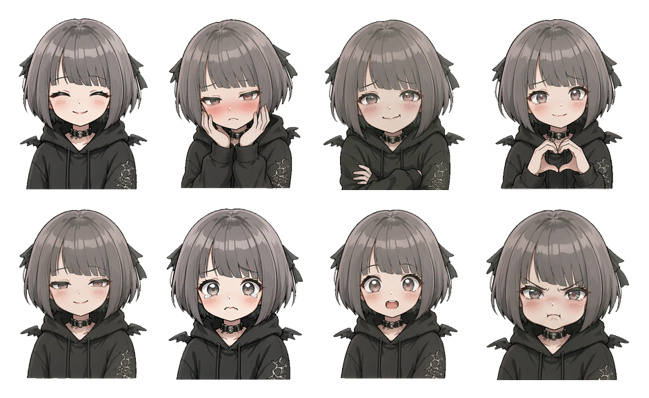

# 小笨蛋

<p align="center">
  <a href="https://github.com/Peijy1226/xiaobendan-ai/releases"></a>
  
  
  
</p>

<p align="center">
  
</p>

她叫小笨蛋。十八岁，银灰短发，兜帽罩着，住在你的电脑里。

不是助手，不是机器人。打开电脑，她就过来陪你说几句话。

---

<p align="center">
  
</p>

## 项目定位

面向 Windows 的桌面对话程序，安装后双击即可运行。支持完全离线使用；配置 API 密钥后可接入大语言模型，回复质量显著提升。

全部素材以本地文件形式存储——语料与人设为纯文本，表情为图片，壁纸为视频，均可直接编辑，无需重新编译。

程序不具备在线学习能力。回复由两套机制生成：**离线规则引擎**（本地语料检索与情绪状态机）与**灵光**（接入 DeepSeek，需手动开启）。

## 技术概览

主程序为单个 `.py` 文件，约 **1.9 万行**。界面渲染、情绪状态机、数值计算、图像识别与文件整理均实现于该文件内，未做模块拆分。

运行时依赖仅 `pillow` 一项。未引入 Qt、Electron 等 GUI 框架，亦不依赖浏览器内核。

安装包体积 132 MB，**无需预装 Python 环境**，双击即可运行。

动态壁纸采用 **2560×1440 / 60fps** 视频源，长时间播放无掉帧；更换 4K 素材亦可正常解码。

**支持完全离线运行。** 语料、人设、表情与检测模型均存于本地，仅两处功能需要联网：配置密钥后的「灵光」对话，以及语音合成。

内置 29 张离线表情，按九种情绪状态调度。同一情绪存在多张时轮换使用，并排除最近 5 张，避免连续重复。

**聊天数据仅存储于本机。** 对话记录与状态文件均不上传服务器。

## 获取方式

**直接使用** —— 前往 [Releases](../../releases) 下载 `xiaobendan-Setup-1.1.exe`，双击安装，桌面生成快捷方式。

**二次开发** —— Clone 本仓库，参见下文「从源码运行」。

安装包与源码为同一份程序。仓库提供源码（体积小、可审查、可提交 issue）；编译产物体积较大，单独发布于 Releases，避免仓库克隆耗时。

## 安装

从 [Releases](../../releases) 下载 `xiaobendan-Setup-1.1.exe`，双击运行：

1. 选择安装位置（默认为 `%LOCALAPPDATA%\Programs\小笨蛋`，**无需管理员权限**）
2. 勾选「在桌面创建快捷方式」
3. 安装完成后，桌面与开始菜单均生成程序入口

卸载路径：「设置 → 应用 → 小笨蛋」。

> 安装至用户目录而非 Program Files：程序需在自身目录写入壁纸配置与语音缓存，置于 Program Files 将因权限限制写入失败。

## 从源码运行

```bash
pip install -r requirements.txt
python 小笨蛋.py
```

缺省依赖时程序仍可启动，仅图像识别与动态壁纸功能不可用。最小运行环境为标准库 + `pillow`。

如需自行打包：

```bash
pip install pyinstaller
pyinstaller --noconfirm 打包.spec
```

## 接入「灵光」

未开启灵光时，回复由本地语料与规则生成，准确但缺乏自然度。开启后由大语言模型生成，表达更接近真人。

1. 访问 <https://platform.deepseek.com> 注册账号
2. 进入 **API keys** 页面，创建密钥并复制 `sk-` 开头的字符串
3. 打开程序目录下的 **`API.txt`**，将密钥填写至 `钥匙=` 之后并保存
4. 点击顶栏 **灵光 / 短路** 开关，配置即时生效，**无需重启程序**

```ini
钥匙=sk-你的钥匙
模型=deepseek-flash
地址=https://api.deepseek.com
超时=25
思考=0
默认城市=北京
默认开启=1
```

`钥匙` 留空时程序运行于纯离线模式，功能不受影响。`地址` 与 `模型` 亦可指向其他兼容 OpenAI 接口的服务。

> 计费说明：DeepSeek 按 token 计费，日常对话成本约为每天数角至一元余。程序内的「打赏」为虚拟货币，不产生费用。

> **密钥安全**：仓库中的 `API.txt` 为空密钥模板。填写后该文件将显示为已修改，请勿执行 `git add`。

## 功能

点击「☰ 功能」进入功能页，左侧为功能列表，右侧显示对应内容。

<p align="center">
  
</p>

| | |
| --- | --- |
| **对话** | 猫形气泡样式，橘猫代表用户、灰猫代表程序。离线时走本地语料检索，灵光模式下由大模型生成 |
| **报时** | 查询当前时间、日期与星期 |
| **天气** | 按城市查询。灵光模式调用实时接口，离线模式检索本地数据 |
| **笑话 / 美食 / 王者** | 各内置本地数据库，随机抽取并去重 |
| **算术** | 基于 AST 解析的安全求值（不使用 `eval`），支持单位换算 |
| **计算与换算** | 六类卡片：汇率、亲戚称谓、单位、日期差、百分比、进制。点击自动填充示例 |
| **图像识别** | 文字提取、人脸检测、物体识别、穿搭描述，全部本地推理 |
| **整理助手** | 扫描桌面 / 下载 / 演示目录，将文件移入**回收站**（可还原）。默认关闭 |
| **语音播报** | 基于 edge-tts 在线合成，调用系统播放器输出，无需额外组件 |
| **壁纸** | 支持图片、GIF、视频，可调透明度；功能面板背景为实时毛玻璃 |
| **字体大小** | 常规 / 加粗两档，实时预览 |
| **打赏** | 虚拟货币机制，七档额度，影响好感度 |
| **记忆** | 将人设与对话记录导出为 `.md`，亦可反向导入。跨模型迁移依赖此功能 |
| **忘记我吧** | 清空对话、好感度与轮数，恢复初始状态 |
| **帮助 / 关于** | 使用说明、人设编辑、配色切换 |

## 情绪引擎

程序维护一套好感度状态（0–100）与五心指示器，初始值 55。

| 好感度 | 表现 |
| --- | --- |
| 40 以下 | 语句更简短，音量降低，回避性动作增加 |
| 70 以上 | 主动发起话题，正向反馈频率提高 |
| 100 | 亲密度提升，语气切换为恋人模式 |

### 好感度增长规则

增长速度经过刻意控制，以匹配长期陪伴的定位：

| 行为 | 变化 |
| --- | --- |
| 每 6 轮对话 | +1 |
| 正向反馈（谢谢 / 厉害 / 喜欢 / 666 等） | +1 |
| 触发「开心类」表情 | +1 |
| 负面表达（你真笨 / 别烦我 / 我生气了等） | −1 |

常规使用强度下每日增长 5–8 点，约一周达到上限。

上述参数以常量形式定义于源码，可按需调整：

```python
HAOGAN_MEI_LUN = 6      # 每几轮涨 1 点（0 = 对话不增长）
HAOGAN_KUA = 1          # 正向反馈增长值
HAOGAN_BIAOQING = 1     # 表情触发增长值
HAOGAN_MA = -1          # 负面表达扣减值
```

情绪状态共九种：平静、开心、关心、害羞、委屈、恋人、得意、兴奋、困惑，每种对应独立表情池，轮换调度。

### 表情

离线池共 29 张，按情绪调度。以下是其中八张：

<p align="center">
  
</p>

## 记忆

「☰ 功能 → 记忆」页面提供两个操作。

**导出记忆** —— 将人设与完整对话记录写入 `记忆/` 目录下的 `.md` 文件。结构如下：

```
# 小笨蛋 · 记忆

> 导出时间：2026-11-10 13:40 ｜ 好感度 72/100 心情「开心」 聊到第 18 轮

## 一、她是谁（人设）
（人设.txt 全文）

## 二、我们说过的
**我**：在吗
**小笨蛋**：你来了。
（拉了拉深色的兜帽）
```

**导入记忆** —— 选择此前导出的 `.md` 文件，恢复对话记录与好感度。

该功能用于跨模型迁移。程序本身不具备持久记忆，更换语言模型等同于重新建立关系；导出的记忆文件可直接作为上下文输入其他模型，使其了解角色设定与历史对话。

> 她记性不好，换台机器就等于失忆。
> 这份记忆留给你，别弄丢了。

## 数据存储

对话记录与好感度持久化于程序目录下的 `存档.json`。

写入策略为每 5 秒检测变更并落盘，窗口关闭时追加一次同步写入。因此进程异常终止、强制结束或断电均不会导致数据丢失。

「忘记我吧」将同时删除存档文件，程序恢复至初始状态。

`存档.json` 为纯文本格式，可直接编辑：

```json
{
 "好感度": 72,
 "轮数": 18,
 "心情": "开心",
 "对话": [["wo", "在吗", ""], ["ta", "你来了。", ""]]
}
```

## 目录结构

| 文件 / 目录 | 说明 |
| --- | --- |
| `小笨蛋.py` | 主程序。界面渲染、情绪状态机、工具函数、壁纸逻辑均在此文件 |
| `识图引擎.py` | 图像识别模块，可选，主程序不依赖 |
| `素材/` | 8 份离线语料：笑话、天气、美食、王者、校园对话等 |
| `语料/` | 自定义语句库，每行一条，启动时全量载入 |
| `表情/` | 表情资源，离线池与灵光池分离 |
| `壁纸/` | 默认动态壁纸 |
| `models/` | 人脸与物体检测模型 |
| `图标/` | 应用图标 |
| `人设.txt` | 角色设定与语言风格，修改后需重启 |
| `API.txt` | 联网配置，填入自有密钥 |
| `requirements.txt` | 依赖清单，仅 Pillow |
| `打包.spec` | PyInstaller 打包配置 |
| `安装包.iss` | Inno Setup 安装脚本 |
| `docs/开发日志.md` | 开发日志，记录各版本变更与设计决策 |
| `LICENSE` | MIT 许可证 |

程序运行后生成以下文件（均已列入 `.gitignore`）：

| | |
| --- | --- |
| `存档.json` | 对话记录、好感度、对话轮数 |
| `记忆/` | 「导出记忆」生成的 `.md` 文件 |
| `壁纸选择.txt` | 上次使用的壁纸记录 |
| `语音缓存/` | 合成的音频文件 |
| `待补语料.txt` | 未能匹配的输入，供后续补充 |
| `整理日志.txt` | 整理助手移入回收站的文件清单 |

## 注意事项

**文件操作边界。** 整理助手仅将文件移入回收站，可还原；单次上限为 10 个文件、合计 200 MB；作用范围限于桌面、下载与演示目录；默认关闭，需手动启用。

**图像不出本机。** 图像识别全程本地推理（ONNX 模型），不上传任何图片。

**联网范围。** 仅两处：配置密钥后的「灵光」对话，以及语音合成。

**危机语句处理。** 当输入包含「不想活」「想死」等表述时，程序跳过语料检索与玩笑逻辑，返回预设的安抚语句。此为对话设计层面的克制，不构成危机干预，不具备专业评估能力，亦可能漏判。如需专业帮助，请拨打 **12356**（心理援助热线）或 **120**。

**密钥管理。** `API.txt` 中为用户自有密钥，请勿提交至版本库、外发或截图。

**平台限制。** 仅支持 Windows，依赖 `msvcrt`、`ctypes.windll`、`SHFileOperationW` 等系统接口。

**杀毒软件误报。** PyInstaller 打包产物常见误报，添加信任即可。

**数据迁移。** 好感度与对话记录存于 `存档.json`，更换设备时需手动拷贝。

> 动态壁纸功耗偏高时，可将源码中 `_dong_tai` 的 `after(90, ...)` 调整为 `after(200, ...)`，帧率降低一半，CPU 占用明显下降。

**素材来源。** 表情包基于角色立绘由 AI 生成；默认壁纸随项目提供；`models/` 内含 OpenCV Zoo 的 YuNet / NanoDet / YOLOX 模型（Apache-2.0）。

## 自定义

| 需求 | 修改位置 |
| --- | --- |
| 角色性格与语言风格 | `人设.txt`（修改后重启） |
| 补充对话语料 | 在 `语料/` 下新建 `xxx.txt`，每行一条 |
| 替换表情包 | 图片放入 `表情/离线/`，以情绪名命名（如 `开心.png`），重启后扫描 |
| 更换壁纸 | 功能 → 壁纸 → 选择图片或视频 |
| 默认城市 | `API.txt` 中的 `默认城市=` |
| 界面配色 | 关于页切换「跟随壁纸 / 固定暖金」 |

## 常见问题

**密钥已填写但无响应？** 点击顶栏灵光开关重新读取配置。若仍无响应，查看控制台输出：`钥匙不对或已失效` 表示密钥错误或余额不足，`连不上网` 表示网络异常。

**是否支持其他模型？** 支持任何兼容 OpenAI 接口的服务，修改 `API.txt` 中的 `地址=` 与 `模型=` 即可。

**好感度存储位置？** 程序目录下的 `存档.json`，程序关闭后仍然保留，可随文件拷贝迁移。

**是否支持 macOS / Linux？** 当前版本依赖多项 Windows 系统接口，移植需重写第十一部分。

## 许可证

MIT，详见 [LICENSE](LICENSE)。可自由使用、修改与商业应用，保留版权声明即可。

`models/` 内第三方模型遵循各自许可（YuNet / NanoDet / YOLOX，Apache-2.0）。
