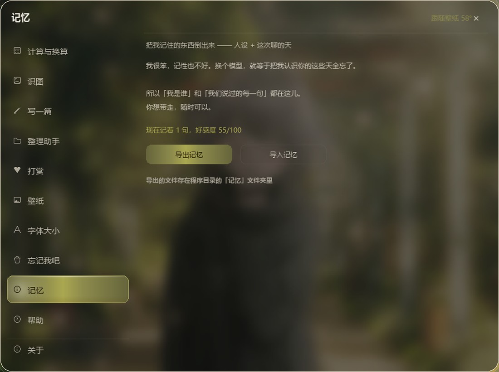
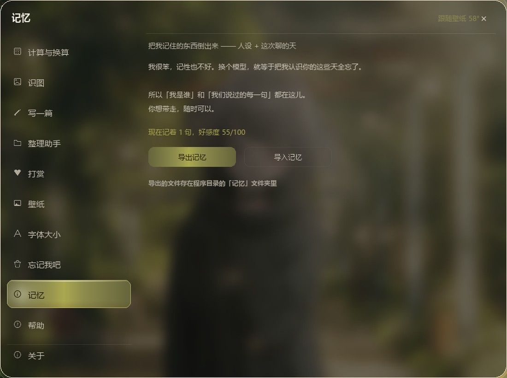

# 小笨蛋

> 一个住在你电脑里的十八岁女孩。不是助手，打开电脑就过来陪你。

<p align="center">
  
</p>

一个单文件的陪伴型聊天程序：**离线也能聊**，填个 API key 就能接大模型说话更自然。
带情绪引擎（好感度 / 五颗心）、表情包、视频壁纸、语音播报、识图、报时、天气、算数与换算。

作者：**Pei**　｜　平台：Windows 10 / 11　｜　语言：Python 3　｜　许可：MIT

---

<p align="center">
  
</p>

## 先说清楚：这是什么，不是什么

**是**——一个能双击就跑、断网也能说话的桌面聊天玩具。所有素材（语料、人设、表情、壁纸）都是本地 txt 和图片，你想改随时改。

**不是**——不是生产力工具，不是客服机器人，不联网不会自己学习。它说的话由两套东西决定：**离线规则引擎**（本地检索 + 情绪状态）和**灵光**（接 DeepSeek，开了才用）。

---

## 这不是心理援助工具

程序里有一处「危机句硬拦截」：说到「不想活」「想死」这类句子时，不走检索、不接玩笑，固定回一组「先接住人」的话（不问原因、不评判、不劝想开、先问当下状态）。源码在第 1550 行附近，改之前请先读上面的注释。

但这只是**对话设计上的克制**，不是危机干预，不具备任何专业评估能力，也可能漏判或被绕过。

如果你或身边的人正处在危机中，请找真实的人：

- **全国心理援助热线 12356**（2025 年 5 月 1 日起全国统一，每日不少于 18 小时）
- 紧急情况：**120** / **110**

---

## 两种拿到它的方式

| 你想干什么 | 下哪个 |
| --- | --- |
| **只想用**，不想装 Python | 到 [Releases](../../releases) 下 `xiaobendan-Setup-1.0.exe`，双击安装，桌面会有图标 |
| **想改代码**，或者想学怎么做的 | 直接 clone 这个仓库，按下面「从源码运行」来 |

安装包和源码是同一份程序。仓库里放源码（体积小、能看能改、能提 issue），安装包放 Releases（因为它是几百 MB 的编译产物，放进 Git 会让仓库变得没法 clone）。

---

## 从安装包安装（普通用户）

到 [Releases](../../releases) 下载 `xiaobendan-Setup-1.0.exe`，双击：

1. 选安装位置（默认装在你自己的用户目录 `%LOCALAPPDATA%\Programs\小笨蛋`，**不需要管理员权限**）
2. 勾「在桌面创建快捷方式」
3. 装完桌面、开始菜单都有「小笨蛋」图标，双击就开

卸载走「设置 → 应用 → 小笨蛋」，或开始菜单里的「卸载 小笨蛋」。

> 为什么装在用户目录而不是 Program Files：程序要在自己目录里写壁纸选择、语音缓存，装进 Program Files 会因为没权限写不进去。

---

## 从源码运行

```bash
# 1. 装依赖（建议 Python 3.10+，Windows）
pip install -r requirements.txt

# 2. 跑
python 小笨蛋.py
```

不装依赖也能启动聊天，只是**识图**和**视频壁纸**会少功能。最小可跑只需要标准库 + `pillow`。

如果你不想配环境，用 `打包.spec` 自己打包：

```bash
pip install pyinstaller
pyinstaller --noconfirm 打包.spec
# 产物在 dist/小笨蛋/
```

---

## 接上「灵光」（可选，但强烈建议）

不开灵光，它靠本地语料和规则回话——答得对，但没灵气。开了灵光，说话像人。

1. 打开 <https://platform.deepseek.com>，注册 / 登录
2. 左边 **API keys** → 创建 → 复制那串 `sk-` 开头的
3. 打开程序目录下的 **`API.txt`**，粘在 `钥匙=` 后面，保存
4. 点顶栏「小笨蛋」右边的 **灵光 / 短路** 开关，立刻生效，**不用重启**

```ini
# API.txt 长这样
钥匙=sk-你的钥匙
模型=deepseek-flash
地址=https://api.deepseek.com
超时=25
思考=0
默认城市=北京
默认开启=1
```

- `钥匙` 留空 = 只能短路着说话（离线模式），一样能聊
- 点开关重新读盘，所以改完文件不用重启程序
- 兼容旧文件名 `灵光开关.txt` / `API配置.txt`，但新装只用 `API.txt`
- **`API.txt` 里的 key 填完不要提交**：这个文件在仓库里是空钥匙的模板，你填上之后 `git status` 会显示它被改动，**别 add 它**（`.gitignore` 已挡掉旧文件名，留 `API.txt` 在库里是为了让新克隆的人一眼知道在哪儿填）
- 地址填 OpenAI 兼容的其他服务也能接（换 `模型` 和 `地址` 即可）

> 费用：DeepSeek 按 token 计费，日常闲聊一天几毛到一两块。程序里「打赏」是假币，不花钱。

---

## 功能一览

按「☰ 功能」按钮或 **F3** 打开功能条。

<p align="center">
  
</p>

| 功能 | 说明 |
| --- | --- |
| **聊天** | 猫形气泡，橘猫是你、灰猫是她。离线走本地语料检索，灵光走大模型 |
| **报时** | 问她现在几点、今天几号、星期几 |
| **天气** | 说城市查天气。连灵光时走实时接口，离线时查本地素材 |
| **笑话** | 内置笑话库，随机 + 去重 |
| **美食** | 按菜系 / 口味推荐，附一句话介绍 |
| **王者荣耀** | 英雄、装备、段位等问答 |
| **算数** | 安全算式求值（AST 解析，不 `eval`），支持单位换算 |
| **计算与换算** | 六张卡：汇率 / 亲戚称谓 / 单位 / 日期差 / 百分比 / 进制。点卡自动填示例 |
| **识图** | 提取文字（OCR）、认人（人脸框）、认物（物体框）、描述穿搭 |
| **整理助手** | 扫桌面 / 下载 / 演示夹，把文件移到**回收站**（可还原）。默认关闭 |
| **语音播报** | 在线合成（edge-tts），用系统播放器放，不需要额外组件 |
| **壁纸** | 换图片 / GIF / 视频背景，透明度可调，面板后面是实时毛玻璃 |
| **字体大小** | 细 / 粗两档，实时预览 |
| **打赏** | 假币（token），从 1 token 到 1M 七档，加好感度 |
| **帮助 / 关于** | 说明、人设编辑（直接改 `人设.txt`）、配色切换 |

---

## 情绪引擎

她记得你。好感度 0–100，五颗心从 1 颗起步，100 才满。

| 状态 | 表现 |
| --- | --- |
| 40 以下 | 话更少，声音更小，常把脸埋进兜帽 |
| 70 以上 | 主动搭话，笑的次数变多 |
| 100 | 靠得近一点，会撒娇，语气转恋人 |

好感度会因为聊天、打赏上涨。心情分「平静 / 开心 / 关心 / 害羞 / 委屈 / 恋人 / 得意 / 兴奋 / 困惑」九种，每种对应一池表情包，同一情绪多张轮流，最近 5 张先排除，不会连着贴同一张。

**危机句是硬拦截**：说到「不想活」「想死」这类词时，不会走检索、不会接玩笑，而是固定回一组「先接住人」的句子（不问原因、不评判、不劝想开、问当下状态）。这块逻辑在源码第 1550 行附近，**改之前请先读上面的注释**。

---

## 目录结构

```
小笨蛋/
├── 小笨蛋.py            主程序（单文件，约 1.9 万行，全部逻辑在这）
├── 识图引擎.py          独立识图模块（可选，主程序不依赖）
├── 打包.spec            PyInstaller 打包配置
├── API.txt              联网配置（填你的 key，不要提交）
├── 人设.txt             她是谁 / 怎么说话（可直接改，重启生效）
├── 语音开关.txt         语音播报开关
├── 整理助手开关.txt     整理功能总闸（默认关）
├── 素材*.txt            离线语料：笑话 / 天气 / 美食 / 王者 / 校园对话…
├── 语料/                你自己攒的句子库，一行一句，启动时全读进来
├── 表情/                表情包（离线 / 灵光 两个池子，29 张）
├── 图标/                应用图标（app_icon.ico：黑色系圆角底 + 暖金边）
├── 壁纸/                默认壁纸 xiaobendan.mp4
├── models/              人脸 / 物体检测 ONNX 模型
├── requirements.txt
├── 安装包.iss            Inno Setup 安装包脚本（生成 Setup.exe）
├── README_小笨蛋.md      开发日志：每一轮改了什么、为什么这么改
├── LICENSE
└── README.md
```

程序运行后还会自动生成：`壁纸选择.txt`（记住上次壁纸）、`语音缓存/`（合成语音 mp3）、`待补语料.txt`（没答上的话，攒着让你补）。这些都是本地产物，已在 `.gitignore` 里。

---

## 注意事项

**安全边界**

- 整理助手**只移到回收站**，可还原；单次最多 10 个文件、合计 200 MB；只认桌面 / 下载 / 演示夹；默认关闭，要先在功能里打开总闸
- 不会上传你的文件。识图全部在本地跑（ONNX 模型），图片不出本机
- 只有两处联网：**灵光**（你填 key 才会发请求）和**语音合成**（edge-tts）

**隐私**

- `API.txt` 里是你的 key，别提交、别发给别人、别截图
- 聊天记录不落盘（除了 `待补语料.txt` 里记的「没答上的那句」），关掉程序就没了
- 装完记得检查一下 `API.txt` 的权限，别放在共享目录里

**已知限制**

- **只支持 Windows**：用了 `msvcrt`、`ctypes.windll`、`SHFileOperationW`（回收站）
- **杀毒软件可能误报**：PyInstaller 打包的 exe 常见误报，加白名单即可
- **第一次识图慢几秒**：要加载 OCR + 检测模型，之后走缓存
- **视频壁纸费 CPU**：2K60 解码 + 每 90ms 合成毛玻璃。嫌热改源码里 `_dong_tai` 的 `after(90, ...)` → `after(200, ...)`
- **单文件 1.9 万行**：没拆模块，是有意的（双击就能跑、拷 U 盘就能带走）。想看某块逻辑，源码里按「第 N 部分」的注释跳
- **情绪状态不持久化**：关掉程序好感度归零

**素材声明**

- 表情包是 AI 生成的（按角色立绘为参考）；默认壁纸 `xiaobendan.mp4` 随项目提供；`models/` 里是 OpenCV Zoo 的 YuNet / NanoDet / YOLOX 模型（Apache-2.0）
- `识图/` 目录刻意留空。识图功能不依赖它，示例图请自备（放自己的图，`cjd.png` 是启动自检读的那张）

---

## 自己改

| 想改什么 | 改哪 |
| --- | --- |
| 她的性格、说话方式 | `人设.txt`（改完重启） |
| 她答不上来的句子 | 往 `语料/` 里新建 `xxx.txt`，一行一句 |
| 表情包 | 图片扔进 `表情/离线/`，文件名用情绪名（`开心.png`），重启扫描 |
| 壁纸 | 功能 → 壁纸 → 选图 / 视频 |
| 默认城市 | `API.txt` 里 `默认城市=` |
| 界面配色 | 关于页可切「跟随壁纸 / 固定暖金」 |

---

## 常见问题

**Q：`钥匙` 填了还是不说话？**
点一下顶栏的灵光开关重新读盘。还不行就看控制台日志——`钥匙不对或已失效` 说明 key 错了或没余额，`连不上网` 说明网络问题。

**Q：能换成别家的模型吗？**
能，只要接口兼容 OpenAI 格式。改 `API.txt` 的 `地址=` 和 `模型=` 就行。

**Q：为什么没有 Mac / Linux 版？**
用了一堆 Windows API（回收站、窗口）。要移植得改第十一部分。

**Q：好感度能存档吗？**
当前版本不存，关掉就归零。

---

## 许可

MIT License，见 [LICENSE](LICENSE)。代码随便用、随便改、商用也行，保留版权声明即可。

`models/` 里的第三方模型遵循各自许可（YuNet / NanoDet / YOLOX，Apache-2.0）。
